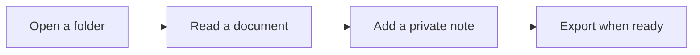

<!-- SPDX-FileCopyrightText: 2026 Outcrop Inc -->
<!-- SPDX-License-Identifier: GPL-3.0-or-later -->
<!-- File GUID: c44bba6f-6cb4-4cfb-954b-3430f2bf50f6 -->
# MonoMark reading example

**Status:** Example document  
**Purpose:** Review reading, navigation, and private notes.

## 1. Read and navigate

Use Files, Contents, Links, and History in the left sidebar. Open [the companion guide](Guide.md) in another tab.
The Markdown document remains a source file. MonoMark keeps your reading data separately until you choose Export.

## 2. Tables and code

| Element | Copy options | Reading task |
| :--- | :--- | :--- |
| Table | CSV, TSV, Markdown | Compare rows |
| Code | Plain text | Inspect a sample |
| Equation | LaTeX, PNG | Check a formula |
| Diagram | Mermaid source, PNG | Follow a flow |

```csharp
public bool IsReady(int count)
{
    return count > 0 && count < 100;
}
```

## 3. Equations and diagrams

$$
E = mc^2
$$



## 4. Highlights and notes

Select this sentence and add a highlight. Add a comment in the right sidebar, then switch to Notes.
Comments and Notes accept standard Paste. Close the document and reopen it to confirm that reading data remains.

## 5. Optional references

Enable both reference options in Settings to try `Guide.md` and §2. File references open a new tab.
These optional view links do not change the source. Existing Markdown links work without either setting.
