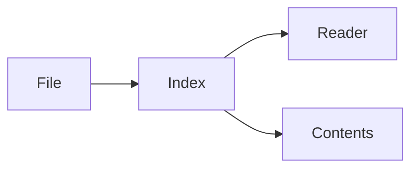

<!--
SPDX-FileCopyrightText: 2026 Outcrop Inc
SPDX-License-Identifier: GPL-3.0-or-later
File GUID: 46638161-e495-4f13-b8b4-ef2182788d29
Created: 2026
-->

# Monoleaf

A monospace Markdown viewer. Open a file or folder to begin reading.

## Reading

- Use the sidebar for Files, Contents, Links, and History.
- Open related documents in native tabs.
- Reading positions and typography stay on this machine.

## Table

| Feature | Status | Detail |
|:---|:---:|---:|
| Markdown | Ready | Local rendering |
| Tables | Ready | Alternating rows |
| Navigation | Ready | Headings and objects |

## Mathematics

An inline expression $E=mc^2$ and a display equation:

$$
\int_0^1 x^2\,dx = \frac{1}{3}
$$

## Diagram



## Code

```swift
let message = "Read without editing."
print(message)
```

## Links

[Markdown reference](https://commonmark.org/) and [back to Reading](#reading).

Unicode works: 日本語, café, and :smile:.
